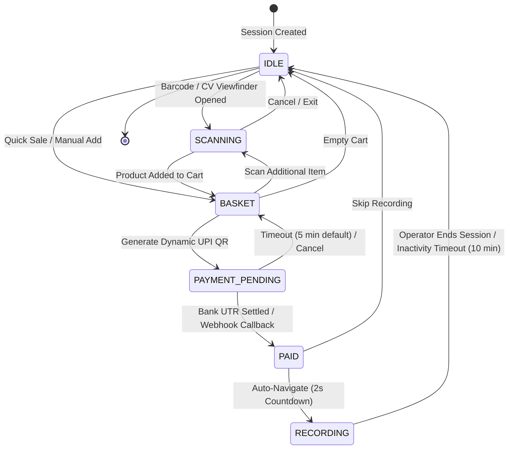
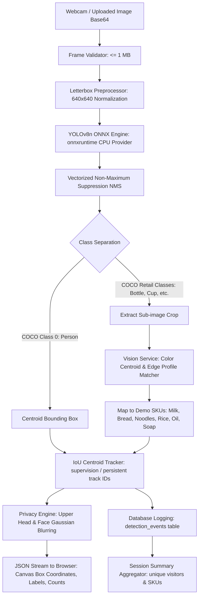
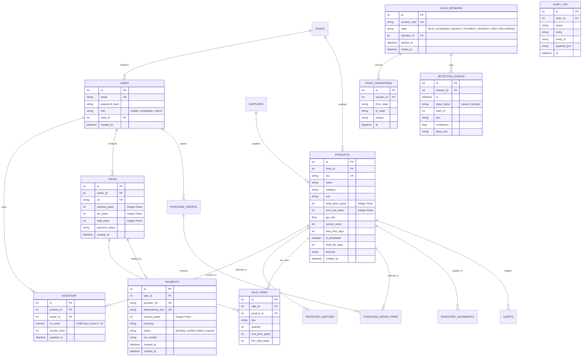
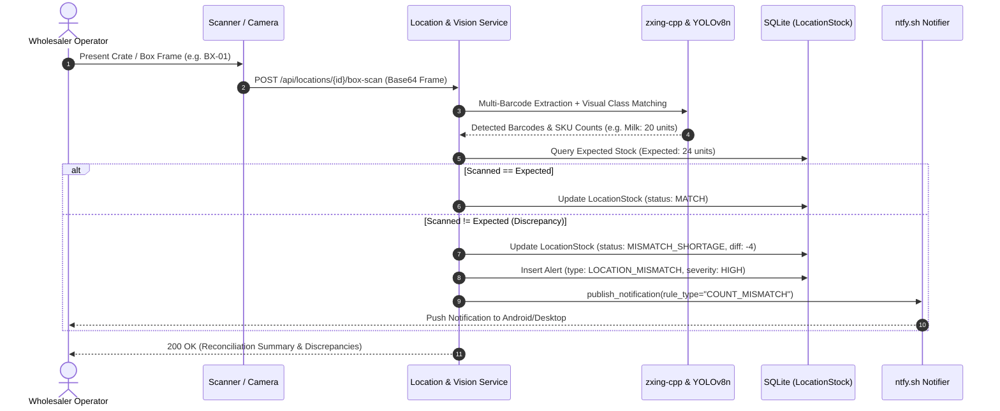

# StockSense AI v2: Architecture Specification
> **Platform**: AI-Powered Retail Inventory Intelligence (Wholesale + Retail + Admin)  
> **Hackathon**: QUANTIX 2K26, Problem Statement PS11 (Small-Retail Reorder Planner)

---

## 1. Architectural Philosophy & Overview

StockSense is architected as a high-performance **modular monolith** designed for small-to-medium retail shops, supermarkets, and wholesale suppliers. The architecture bridges the critical information gap between retailers (who order based on intuition and experience stockouts or spoilage) and wholesalers (who lack visibility into upstream demand).

### High-Level Topology
```
           +-------------------------------------------------------------+
           |               React 19 + TypeScript + Vite UI               |
           |   (Tailwind CSS, Recharts, Lucide Icons, Tabular Numerals)   |
           +-------------------------------------------------------------+
                                          |
                                    REST / JSON
                                          v
+-------------------------------------------------------------------------------+
|                             Flask REST Application                            |
|                                                                               |
|  [Security & RBAC Middleware]                                                 |
|    - Roles: Customer/Retailer, Wholesaler, Platform Administrator             |
|    - Password Hashing (PBKDF2-HMAC-SHA256) & Token Sessions                   |
|    - Tenant Data Scoping (shop_id isolation)                                  |
|                                                                               |
|  [Ingestion & Pipeline Engine]                                                |
|    - Background Watched Folder Scanner (`data_inbox/` auto-routing)           |
|    - Universal CSV Ingestion: Sales, GST Invoices, Stock Snapshots, Market    |
|    - Audit Run Logging with ACID rollback on failure                          |
|                                                                               |
|  [Intelligence & Calculation Services]                                        |
|    - Forecasting Service: Daily ADD, Linear Trend, ISO Weekly Aggregation    |
|    - Replenishment Service: Lead-Time Demand, Safety Stock, Inventory Position|
|    - Hard Shelf-Life Cap Service: Usable Selling Window Spoilage Ceiling      |
|    - Priority Scoring Engine: Multi-factor explainable ranking (100-pt scale) |
|    - Automated Alert Engine: Rule evaluation, deduplication, auto-resolution  |
|    - Purchase Order Flow: Retailer order creation -> Wholesaler fulfillment   |
|                                                                               |
+-------------------------------------------------------------------------------+
                                          |
                                    ACID Storage
                                          v
                           +-----------------------------+
                           |     SQLite 3 Database       |
                           |  (WAL Mode, Foreign Keys)   |
                           +-----------------------------+
```

---

## 2. Stakeholder Roles & Access Control (RBAC)

Lightweight, local authentication using salted PBKDF2 password hashes and session tokens with tenant-scoped data isolation.

| Stakeholder Role | Permitted Pages & Capabilities | Restricted Boundaries | Demo User |
|---|---|---|---|
| **Customer / Retailer** *(Primary)* | Dashboard, Inventory, Sales & Ingestion (Sales, GST, Stock, Market), Demand Forecast (Daily + Weekly), Reorder Planner, Alerts, Purchase Orders (Raise), Reports. | Cannot modify wholesale pricing or view other stores' inventory. | `retailer@stocksense.in` / `retailer123` |
| **Wholesaler** | Wholesale Overview, Incoming Purchase Orders (Confirm, Dispatch, Deliver), Wholesale Catalog (SKUs, MOQ, Pack Size, Price, Lead Time), Anonymized Upstream Demand Signals, Reports. | Cannot see individual retail transactions or unshared store data. | `wholesaler@stocksense.in` / `wholesaler123` |
| **Administrator** | System Health, User Management (Create, Toggle, Role Assignment), Pipeline Audit Run Logs, Manual Pipeline Execution, Demonstration Data Re-seeding & Reset. | Requires confirmation dialog for destructive actions. | `admin@stocksense.in` / `admin123` |

---

## 3. Automated Data Pipeline Architecture

Progress and data flow are automated end-to-end to eliminate manual operator interventions.

### 3.1 Watched Inbox Folder (`data_inbox/`)
- A background worker polls `data_inbox/` periodically.
- When CSV files are dropped into `data_inbox/`:
  1. The pipeline inspects file headers to classify the file type:
     - `invoice_no` + `gstin_counterparty` or `hsn_code` $\rightarrow$ **GST Invoice Import**
     - `quantity_on_hand` + `as_of_date` $\rightarrow$ **Stock Snapshot Reconciliation**
     - `signal_type` + `scope_value` $\rightarrow$ **Market Signals Import**
     - `quantity_sold` + `sale_date` $\rightarrow$ **Direct Sales Ledger Import**
     - `unit_cost` + `selling_price` $\rightarrow$ **Product Master Data**
  2. The file is validated row-by-row.
  3. Valid records are committed inside a database transaction.
  4. If valid rows $> 0$, the file is moved to `data_processed/` along with an execution audit report.
  5. If validation fails completely, the file is moved to `data_rejected/`.
  6. **Automatic Recompute**: Successful ingestion automatically triggers forecasting refresh, reorder plan recalculation, and alert rule evaluation.

---

## 4. Business Logic & Mathematical Formulas

### 4.1 Demand Estimation
#### Daily Average Daily Demand (ADD)
$$\text{ADD} = \frac{\sum_{t \in W} \text{Sales}_t}{|W|}$$
*Missing dates in the window are explicitly zero-filled to avoid inflating demand.*

#### ISO Weekly Forecast
Sales are aggregated into ISO calendar weeks. Partial weeks at boundaries are normalized by active day ratios.
$$\text{Weekly Demand} = \sum_{d=1}^{7} \text{DailySales}_d$$
Confidence bounds are computed using residual variance across historical weeks:
$$\text{Lower Bound} = \max(0, \text{Forecast} - 1.5 \times \sigma_{\text{residual}})$$
$$\text{Upper Bound} = \text{Forecast} + 1.5 \times \sigma_{\text{residual}}$$

#### Bounded Market Adjustment Multiplier
When external market signals exist (festivals, localized demand indices), a bounded multiplier $M \in [0.80, 1.40]$ adjusts the forecast:
$$\text{Adjusted ADD} = \text{ADD}_{\text{baseline}} \times M$$

---

### 4.2 Replenishment Calculations
1. **Lead-Time Demand (LTD)**:
   $$\text{LTD} = \text{ADD} \times \text{LeadTimeDays}$$
2. **Safety Stock (SS)**:
   $$\text{SS} = \text{ADD} \times \text{SafetyBufferDays}$$
3. **Reorder Point (ROP)**:
   $$\text{ROP} = \text{LTD} + \text{SS}$$
4. **Target Stock**:
   $$\text{TargetStock} = \text{ADD} \times (\text{LeadTimeDays} + \text{CoverageDays}) + \text{SS}$$
5. **Inventory Position (Double-Ordering Prevention)**:
   $$\text{InventoryPosition} = \text{CurrentStock} + \text{IncomingUnitsInTransit} - \text{BackorderedUnits}$$
   *$\text{IncomingUnitsInTransit}$ aggregates all un-received units across `Submitted`, `Confirmed`, and `Dispatched` Purchase Orders.*
6. **Base Deficit**:
   $$\text{BaseDeficit} = \max(0, \text{TargetStock} - \text{InventoryPosition})$$

---

### 4.3 Hard Shelf-Life Cap Engine

For perishable products, over-ordering guarantees spoilage before items can be sold.

1. **Usable Selling Window**:
   $$S_{\text{usable}} = \text{ShelfLifeDays} - \text{LeadTimeDays} - \text{BufferDays}$$
   *If $S_{\text{usable}} \le 0$, supplier lead time is incompatible with product shelf life; order quantity is blocked to 0 with a Critical alert.*

2. **Shelf-Life Cap (Units)**:
   $$\text{Cap} = \max\Big(0, \; (\text{ADD} \times S_{\text{usable}}) - \text{ExistingSellableStock}\Big)$$

3. **Application & Packaging Constraint**:
   $$\text{ConstrainedQty} = \min(\text{BaseDeficit}, \text{Cap})$$
   - Rounded **down** to pack size to ensure no units exceed shelf life.
   - If the resulting quantity falls below the supplier MOQ:
     $$\text{FinalRecommendedQty} = 0$$
     *(Prevents purchasing an MOQ volume that is mathematically guaranteed to spoil before sale).*

---

### 4.4 Explainable Priority Scoring Engine

Every product receives a deterministic 0 to 100 priority score:

| Signal Component | Mathematical Condition | Maximum Score Contribution |
|---|---|---|
| **Stockout Urgency** | $D = \text{DaysToStockout} \le L \text{ (LeadTime)}$ | 40 points ($\text{score} = 40 \times (1 - D / L)$) |
| **Lead-Time Deficit** | $\text{InventoryPosition} < \text{LTD}$ | 20 points |
| **Buffer Depletion** | $\text{InventoryPosition} < \text{ROP}$ | 15 points |
| **Lost Sales Margin Impact** | $\text{ADD} \times (\text{SellingPrice} - \text{UnitCost})$ | 15 points |
| **Forecast Upward Trend** | Positive trend slope / festival signal | 10 points |

#### Priority Classification Thresholds:
- **CRITICAL**: Score $\ge 70$ or $\text{DaysToStockout} \le \text{LeadTime}$
- **HIGH**: Score $\ge 45$ or $\text{InventoryPosition} \le \text{ReorderPoint}$
- **MEDIUM**: Score $\ge 25$ or $\text{InventoryPosition} < \text{TargetStock}$
- **HEALTHY**: Score $< 25$

---

## 5. Automated Alert Rules & Deduplication

Alerts run automatically after every ingestion or recompute.
- **Deduplication**: If an active `OPEN` alert exists for `(alert_type, product_id)`, no duplicate alert is generated.
- **Auto-Resolution**: When the underlying condition clears (e.g. stock arrives, inventory position exceeds reorder point), active alerts are automatically transitioned to `RESOLVED` with timestamp.
- **Severity Levels**: `CRITICAL` (stockout imminent), `HIGH` (ROP reached, expiry risk), `MEDIUM` (stale data), `INFO` (pipeline success).

---

## 6. Purchase Order & Inventory Movement Flow

```
[Reorder Planner Recommendations]
               |
      Retailer clicks "Create PO"
               v
   [Purchase Order: Submitted] ---------> (Units count toward Retailer Inventory Position)
               |
      Wholesaler reviews PO
               v
   [Purchase Order: Confirmed]
               |
      Wholesaler dispatches goods
               v
   [Purchase Order: Dispatched]
               |
      Retailer receives shipment
               v
   [Purchase Order: Delivered] ---------> Creates `receipt` in `inventory_movements`
                                           Updates `products.current_stock`
```

---

## 7. Automated Checkout Session State Machine

The checkout session is governed by an explicit server-side state machine (`backend/services/state_machine.py`) that acts as the single source of truth for both POS barcode scanning and automated computer vision analytics.



### State Transition Invariants
1. **Single Source of Truth**: State transitions are evaluated by `SessionRepository` and written with timestamped audit rows in `state_transitions`.
2. **Server-Side Timeouts**: `PAYMENT_PENDING` expires automatically after configurable minutes (`payment_timeout_minutes`) and reverts to `BASKET`. `RECORDING` auto-finalizes to `IDLE` after inactivity.
3. **Automated Navigation**: On `PAID`, the POS terminal immediately schedules a skippable 2-second countdown and redirects to `/record`.

---

## 8. Real-Time Object Detection Pipeline

The detection pipeline runs completely offline on laptop CPU with zero cloud latency, operating at $\ge 19$ FPS at 640px resolution.



---

## 9. SQLite Database Schema (ER Diagram)

The database schema is managed via SQLAlchemy 2.x ORM and Alembic migrations at `backend/data/stocksense.db` with WAL mode and foreign key enforcement enabled on every connection. All monetary amounts are stored as integer paise (`INTEGER`) to eliminate float precision loss.



---

## 9. Four-Role RBAC & Multi-Tenant Isolation

The platform enforces strict role separation across 4 distinct user personas, ensuring each actor can only access their permitted domain:

```mermaid
graph TD
    User([Authenticated User]) --> AuthMiddleware{Role & Tenant Gatekeeper}
    
    AuthMiddleware -->|role: retailer| RetailerZone[Retailer Domain]
    AuthMiddleware -->|role: wholesaler| WholesalerZone[Wholesaler Domain]
    AuthMiddleware -->|role: dealer| DealerZone[Dealer Domain]
    AuthMiddleware -->|role: admin| AdminZone[Superuser Admin Domain]

    subgraph Retailer Domain
        RetailerZone --> POS[Front-Counter POS & Checkout]
        RetailerZone --> Barcode[Multi-Format Barcode Scanner]
        RetailerZone --> Shelf[Store Shelf View & Alerts]
        RetailerZone --> RetailPO[Raise Purchase Orders]
    end

    subgraph Wholesaler Domain
        WholesalerZone --> WhCatalog[Bulk Wholesale Catalog]
        WholesalerZone --> WarehouseLoc[Warehouse Hierarchy & Box Scan]
        WholesalerZone --> CratePO[PO Fulfillment & Dispatches]
        WholesalerZone --> DemandSig[Upstream Demand Signals]
    end

    subgraph Dealer Domain
        DealerZone --> BrandDsp[Brand-Level Order Dispatches]
        DealerZone --> Tiers[Volume Bulk Pricing Tiers]
        DealerZone --> RegionalAlloc[Regional Warehouse Allocations]
    end

    subgraph Superuser Admin Domain
        AdminZone --> UserMgmt[User & Tenant Management]
        AdminZone --> SysAudit[System Audit Logs & Database Health]
        AdminZone --> Retrain[Model Retraining Triggers]
    end

    RetailerZone -.->|403 Forbidden| WhCatalog
    RetailerZone -.->|403 Forbidden| UserMgmt
    WholesalerZone -.->|403 Forbidden| POS
    DealerZone -.->|403 Forbidden| WarehouseLoc
    DealerZone -.->|403 Forbidden| UserMgmt
```



---

## 10. Warehouse Hierarchy & Box Scan Architecture

Physical inventory tracking utilizes a recursive storage hierarchy (`shelf` -> `bin` -> `box`). Automated box scanning runs barcode decoding + YOLOv8n matching, deduplicating instances and reconciling against expected stock levels:



---

## 11. Multi-Channel Push Notification Pipeline (ntfy.sh)

Alerts triggered by low stock, perishable expiration risks, payment settlement, or scanner hardware faults are dispatched securely via `ntfy.sh`:

```mermaid
graph LR
    TriggerEvent[Trigger Event] --> RuleFilter{Rule Evaluator}
    
    RuleFilter -->|Stock <= ROP| LowStock[LOW_STOCK Alert]
    RuleFilter -->|Days to Expire < Buffer| ExpiryRisk[EXPIRY_RISK Alert]
    RuleFilter -->|Webhook Verified| PaySettled[PAYMENT_VERIFIED Alert]
    RuleFilter -->|Box Count != Expected| Mismatch[COUNT_MISMATCH Alert]
    RuleFilter -->|Camera Drop / Error| CamFail[SCANNER_FAILURE Alert]

    LowStock --> DedupEngine{Dedup Cache}
    ExpiryRisk --> DedupEngine
    PaySettled --> DedupEngine
    Mismatch --> DedupEngine
    CamFail --> DedupEngine

    DedupEngine -->|Key in cache| Discard((Suppress Duplicate))
    DedupEngine -->|New Alert| PrivacyFilter[Privacy Preserving Redactor]
    
    PrivacyFilter -->|Zero PII / Summaries Only| NtfyService[ntfy.sh Client]
    NtfyService -->|HTTP POST| NtfyServer[(ntfy.sh Server)]
    NtfyServer --> MobileApp[Android / iOS App]
    NtfyServer --> DesktopWeb[Desktop Webhook / Browser]


